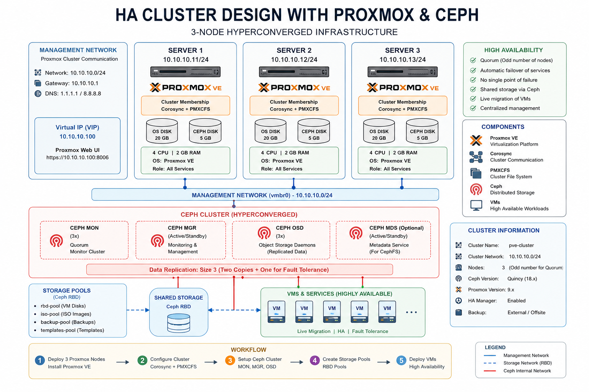

### Proxmox Virtual Environment (Proxmox VE)

Its an open-source virtualization platform built on Debian Linux. It lets you **create**, **run**, **manage**, **monitor**, and protect virtual machines and Linux containers from a centralized web interface.

It combines technologies including:

- `KVM/QEMU:` Full virtual machines with their own guest operating systems.
- `LXC:` Lightweight Linux system containers.
- `Linux networking:` Virtual bridges, VLANs, bonds and software-defined networking.
- `Storage integration:` Local disks, ZFS, NFS, iSCSI, Ceph and other supported backends.
- `Cluster management:` Multiple nodes managed as one environment.
- `High availability:` Automatic recovery of configured workloads after eligible failures.
- `Backup and restore:` Protection and recovery of VMs and containers.

### Enterprise Private Cloud & Application Platform

1. `Project ID:` private-cloud-platform
2. `Approach:` Architecture → Implementation → Validation → Documentation
3. `Environment:` Ubuntu 24.04 LTS + VirtualBox + Proxmox VE + Ceph
4. `Application stack:` Oracle AI Database 26ai + Java 25 + Spring Boot + Next.js

### Project's master plan

| Phase | Project milestone                  | Expected result                                             |
| ----- | ---------------------------------- | ----------------------------------------------------------- |
| 01    | Host and virtualization foundation | Verified Ubuntu host, VirtualBox, resource and network plan |
| 02    | Proxmox VE cluster                 | Three-node cluster with healthy quorum                      |
| 03    | Ceph distributed storage           | Healthy OSDs, replicated storage pool, validated I/O        |
| 04    | High availability                  | Migration, recovery and failure-testing exercises           |
| 05    | Oracle Database 26ai               | Database deployment, connectivity, backup and restoration   |
| 06    | Java 25 + Spring Boot              | Backend API deployed and connected to Oracle                |
| 07    | Next.js                            | Frontend deployed and integrated with the backend           |
| 08    | Security engineering               | Network segmentation, TLS, identity and hardening           |
| 09    | Observability                      | Metrics, logs, dashboards and alerts                        |
| 10    | Automation and disaster recovery   | Infrastructure automation, backup and recovery procedures   |

### Complete private-cloud project

| Phase | Component             | Learning objective                                           |
| ----- | --------------------- | ------------------------------------------------------------ |
| 1     | Ubuntu + VirtualBox   | Host preparation, resource allocation, nested virtualization |
| 2     | Proxmox VE            | Three-node cluster, networking, quorum                       |
| 3     | Ceph                  | OSDs, MONs, replicated pools, storage health                 |
| 4     | Proxmox HA            | VM migration, failure testing, recovery                      |
| 5     | Oracle Database 26ai  | Database deployment, storage, backup, and recovery           |
| 6     | Java 25 + Spring Boot | Backend services and API deployment                          |
| 7     | Next.js               | Frontend deployment and reverse-proxy integration            |
| 8     | Security              | Network segmentation, TLS, IAM, secrets, and hardening       |
| 9     | Observability         | Metrics, logs, dashboards, and alerts                        |
| 10    | Automation and DR     | Terraform/Ansible, backups, and disaster-recovery exercises  |
